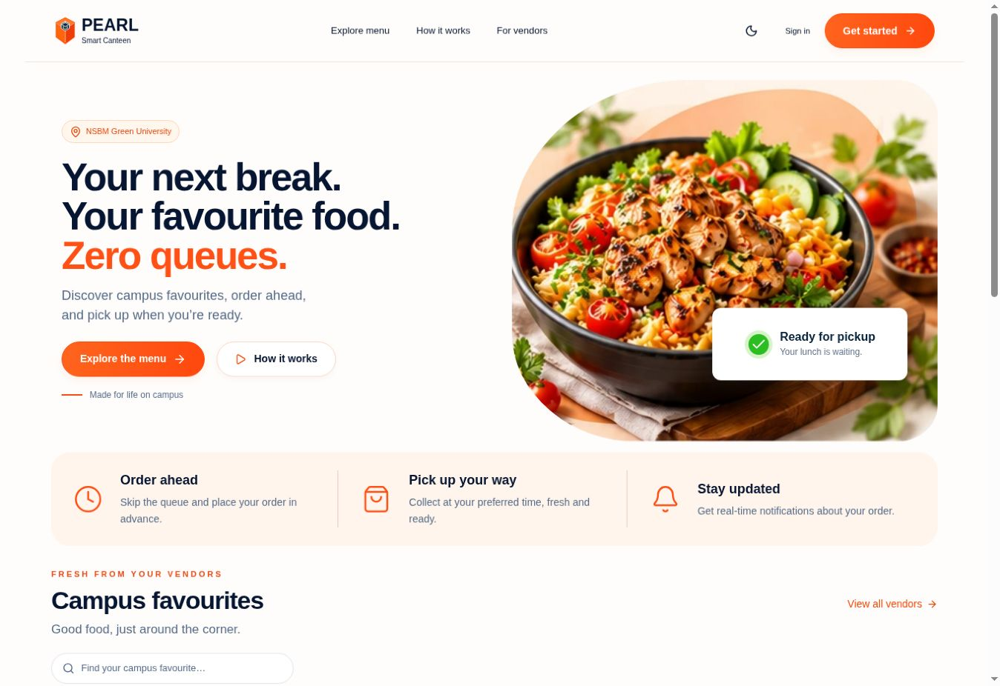
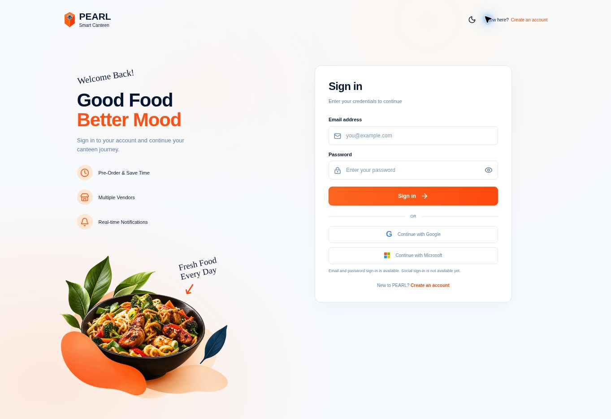
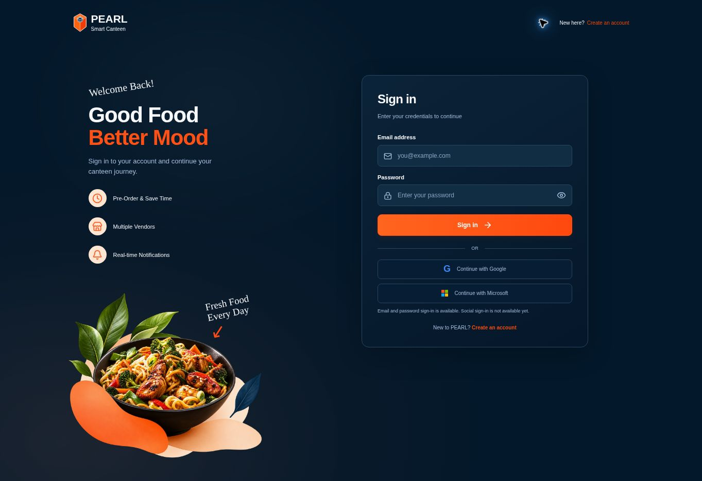

# PEARL · Smart Canteen

**Campus dining, zero queues.**

PEARL is a full-stack university canteen pre-ordering app. Students discover campus vendors, reserve meals and pickup times, track orders, and collect food with a single-use pickup code. Vendors manage their shops, daily portions, orders, and sales from a dedicated workspace.

[Open the live app](https://www.pearll.lk) · [Setup & deployment](docs/demo-deployment.md) · [Backend API](smartcanteen-backend/README.md)

> **Demo status:** The hosted app supports simulated payments. Live PayHere payments remain unverified. Use test accounts and demo orders; this is not a verified live-payment service.

## UI preview

Actual captures of the hosted public interface. These show the landing page and sign-in screens; authenticated student/vendor dashboards are not pictured.

### Landing page



### Sign in · light and dark

| Light theme | Dark theme |
| --- | --- |
|  |  |

Screenshot files live in [docs/images](docs/images). To refresh the gallery, replace these files with current captures using the same filenames. Add student, vendor, or mobile captures there and reference them with relative paths. Remove personal details, order identifiers, and pickup codes before publishing authenticated screenshots.

## What you can do

| Student | Vendor |
| --- | --- |
| Browse, search, filter, and sort meals and vendors | Create and update a shop without admin approval |
| Save favourite meals and vendors | Add and edit meals, photos, prices, and daily portions |
| Keep a basket per account and review repeat orders | Set opening hours, open days, and pause ordering |
| Choose an available pickup slot and place an order | Follow incoming paid orders and update preparation status |
| Track order status and receive in-app notifications | Verify a QR or backup pickup code before collection |
| View order history, receipts, and pickup codes | View sales summaries and best-selling meals |

Shared features include responsive layouts, persistent light/dark themes, email/password accounts, and LKR prices.

## How ordering works

1. A vendor publishes a shop and adds meals with available daily stock.
2. A student chooses meals from one vendor and selects a pickup slot.
3. The backend reserves stock and slot capacity in a MongoDB transaction.
4. A supported payment confirmation settles the reservation. Unpaid holds expire and release capacity.
5. The vendor prepares the paid order and marks it ready.
6. The student presents a QR or backup code; vendor verification completes pickup once.

The default reservation duration is 10 minutes. Business-day and opening-hour checks use the Asia/Colombo timezone.

## Engineering highlights

- **Transactional reservations:** Stock and pickup capacity are held together to reduce overselling.
- **Reservation expiry:** A background worker releases expired unpaid holds.
- **Verified payment callbacks:** The PayHere integration checks server-priced amounts and signatures, with idempotent settlement.
- **Single-use pickup:** Atomic pickup verification prevents the same code from completing an order twice.
- **Authentication and authorization:** JWT access/refresh tokens, password hashing, role checks, and ownership checks.
- **Realtime updates:** Socket.IO supplements durable in-app notifications.
- **Separate deployment tiers:** React on Vercel, a long-running Express/Socket.IO server on Railway, and MongoDB Atlas.

## Technology

| Layer | Technologies |
| --- | --- |
| Frontend | React 19, React Router, Create React App, CSS, Lucide icons |
| API | Node.js, Express, express-validator |
| Database | MongoDB, Mongoose, multi-document transactions |
| Authentication | JSON Web Tokens, bcryptjs |
| Realtime | Socket.IO |
| Pickup | qrcode.react, ZXing browser scanner |
| Testing | Jest, Supertest, Testing Library, mongodb-memory-server |
| Hosting & checks | Vercel, Railway, MongoDB Atlas, GitHub Actions |

## Repository guide

| Path | Purpose |
| --- | --- |
| `smartcanteen-backend/src/` | Express API, models, services, authentication, realtime events, and tests |
| `smartcanteen-backend/scripts/` | Database migration utilities |
| `smartcanteen-frontend/smartcanteen-frontend/src/` | React pages, shared components, state, and styles |
| `smartcanteen-frontend/smartcanteen-frontend/public/` | Public assets and illustrations |
| `docs/images/` | README screenshots |
| `docs/demo-deployment.md` | Hosted demo configuration and verification |
| `docs/first-release.md` | Release scope and implementation notes |
| `.github/workflows/first-release.yml` | Backend tests, frontend tests, and build checks |
| `railway.json` | Backend deployment configuration |

## Run locally

### Requirements

- Git, npm, and Node.js 24, matching the repository's CI configuration.
- MongoDB Atlas or another MongoDB replica set. Standalone MongoDB is not supported because reservations require transactions.
- Two independent JWT signing secrets.

### 1. Clone the repository

```bash
git clone https://github.com/oshada28nilendra-debug/smartcanteen-pearl.git
cd smartcanteen-pearl
```

### 2. Start the backend

```bash
cd smartcanteen-backend
npm ci
cp .env.example .env
```

On Windows, you can copy the example file in VS Code and rename the copy to `.env`.

Edit `.env` with your own values:

```dotenv
NODE_ENV=development
PORT=5000
MONGO_URI=<your MongoDB replica-set connection string>
JWT_SECRET=<your first random signing secret>
JWT_REFRESH_SECRET=<your second independent signing secret>
CLIENT_URL=http://localhost:3000
ENABLE_DEMO_PAYMENTS=true
PAYHERE_SANDBOX=true
```

For simulated payments, leave merchant credentials unset. Use a separate development database.

```bash
npm run dev
```

Health endpoint: `http://localhost:5000/api/health`.

### 3. Start the frontend

In a second terminal, from the repository root:

```bash
cd smartcanteen-frontend/smartcanteen-frontend
npm ci
```

Create or update `.env.local`:

```dotenv
REACT_APP_API_URL=http://localhost:5000/api
```

```bash
npm start
```

Open `http://localhost:3000`. Restart the frontend after changing its environment variables.

### 4. Try the flow

Register separate vendor and student accounts. As the vendor, save shop details, choose opening hours, add a meal, and set daily portions. As the student, browse the menu and place a simulated order. Return to the vendor account to prepare it and verify pickup.

## Tests and build

Run backend tests from `smartcanteen-backend`:

```bash
npm test
```

Run frontend tests and a production build from `smartcanteen-frontend/smartcanteen-frontend`:

```bash
npm test -- --watchAll=false --runInBand
npm run build
```

Backend integration tests use an ephemeral MongoDB replica set. The first run downloads a MongoDB binary; restricted environments can supply a compatible local binary through `MONGOMS_SYSTEM_BINARY`. Test data is separate from the application's configured database.

## Deployment

| Service | Configuration |
| --- | --- |
| Vercel frontend root | `smartcanteen-frontend/smartcanteen-frontend` |
| Frontend build / output | `npm run build` / `build` |
| Frontend API variable | `REACT_APP_API_URL=https://YOUR-BACKEND-HOST/api` |
| Railway backend root | `smartcanteen-backend` |
| Backend start command | `npm start` |
| Backend frontend origin | `CLIENT_URL=https://www.pearll.lk` for the current public site |
| Database | MongoDB Atlas or another replica set |

The release is merged into `main`. Configure both hosts to track `main` for subsequent releases; the branch setting is controlled in each host's dashboard.

Frontend environment variables are embedded at build time, so changing them requires rebuilding. Keep database credentials, JWT secrets, and merchant secrets in backend environment variables only.

For a hosted simulated-payment demo, use a separate database, `NODE_ENV=staging`, and `ENABLE_DEMO_PAYMENTS=true`. Production mode disables simulated payments. See [the deployment guide](docs/demo-deployment.md) for details.

**Existing data:** Before applying the first-release migration to an older database, back it up and pause writes. Review [the backend migration instructions](smartcanteen-backend/README.md) before running any migration; do not run it automatically on an existing deployed database.

## Current scope and limitations

- Student and vendor workflows are active. Admin pages and the admin API are not mounted.
- Email/password authentication is supported. Google/Microsoft sign-in and password recovery are not implemented.
- Notifications are in-app; browser/device push notifications are not implemented.
- Live PayHere payments and callbacks still need separate end-to-end validation before accepting real payments.
- Late successful payments after reservation expiry require manual reconciliation/refund review.
- Wallet top-ups, loyalty, reviews, and automated refunds are outside the current release.
- Camera pickup requires browser camera permission and device testing; manual code verification is also available.

## Contributing

Open an issue describing the problem or proposed change. Use a feature branch, include relevant tests for behavior changes, run the checks above, and open a pull request with a clear description and validation results.

## Author

[Oshada Nilendra](https://github.com/oshada28nilendra-debug)
